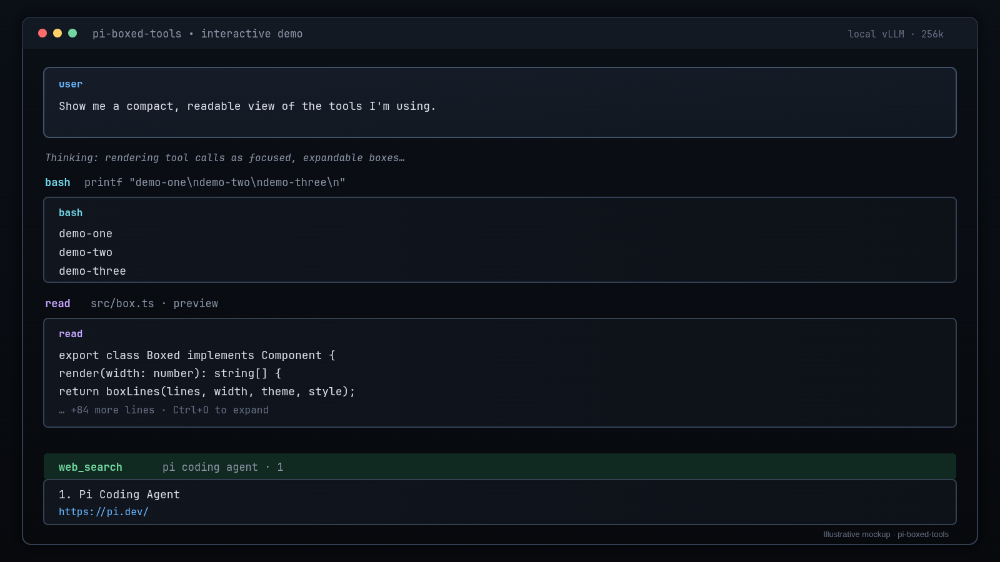
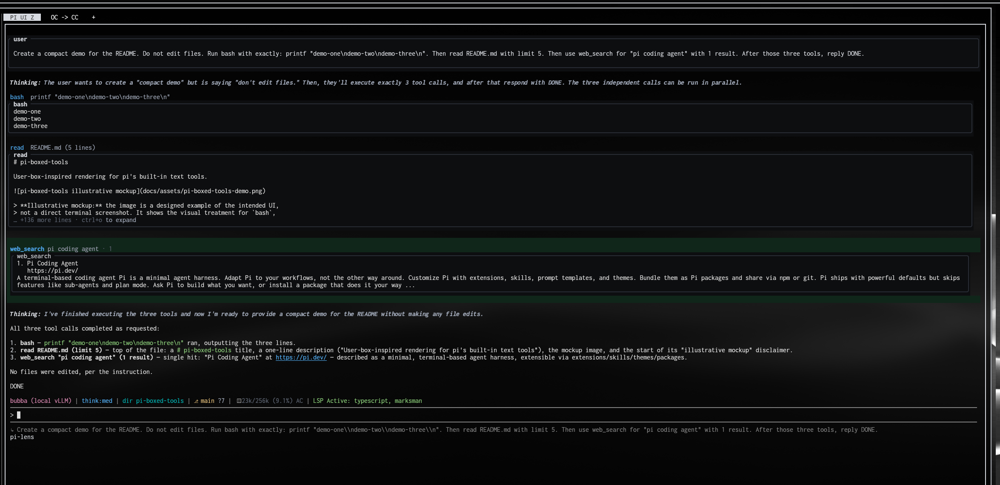

# pi-boxed-tools

User-box-inspired rendering for pi's built-in text tools.



> **Illustrative mockup:** the first image is a designed example of the intended
> UI, not a direct terminal screenshot.

### Live-style editor demo



This second image is a real pi editor pane captured from a Herdr split with
`grim`. It runs deliberately small, non-mutating demo operations through
`bash`, `read`, and `web_search`, so it shows the plugin in its actual editor
context without unrelated desktop or browser chrome.

`pi-boxed-tools` gives `read`, `grep`, `find`, `ls`, and `bash` a consistent,
focused frame inspired by pi's user-message box while leaving
[`pi-tool-display`](https://github.com/MasuRii/pi-tool-display) in charge of
its excellent `edit`/`write` diff rendering and native user-message box.

## What it does

- Rounded, width-safe tool-result frames with `╭─ title ─╮` / `╰────╯` edges
- Theme-aware `border`, `accent`, and `userMessageBg` colors
- Slim one-line call headers
- Collapsed previews with configured expand hints (newest lines for `bash`, first lines for file and listing tools)
- Full output through pi's normal tool expansion behavior
- Error, empty-result, and streaming states (live tail of running output)
- Display-only: pi's own tools, settings (`shellCommandPrefix`, `shellPath`,
  `images.autoResize`), prompt metadata, and execution are left untouched
- No changes to pi core and no runtime dependencies beyond pi's peer packages

The package registers renderers through pi's
[`registerToolRenderer`](https://pi.dev/docs/latest/extensions#tool-rendering)
API with `renderShell: "self"`; it never replaces a tool. pi consults renderer
resolvers before a tool's own renderers, so the boxes apply even when another
extension overrides one of these tools.

## Ownership split with pi-tool-display

This package is deliberately **not a fork** of pi-tool-display. The packages
work together:

| Tool                                                | Owner                                |
| --------------------------------------------------- | ------------------------------------ |
| `read`, `grep`, `find`, `ls`, `bash`                | `pi-boxed-tools`                     |
| `edit`, `write`                                     | `pi-tool-display`                    |
| User message box and thinking labels                | `pi-tool-display`                    |
| `web_search`, `fetch_content`, `get_search_content` | Companion local web-search extension |

The boxes take precedence over pi-tool-display's renderers either way. Still
disable pi-tool-display's tool overrides for these five tools, so the tools
themselves stay pi's built-ins (which honor your shell and image settings):

```json
{
  "registerToolOverrides": {
    "read": false,
    "grep": false,
    "find": false,
    "ls": false,
    "bash": false,
    "edit": true,
    "write": true
  }
}
```

The setting lives in:

```text
~/.pi/agent/extensions/pi-tool-display/config.json
```

Then run `/reload`.

## Installation

From this repository:

```bash
pi install git:github.com/BubbatheVTOG/pi-boxed-tools.git
```

Or install the local checkout while developing:

```bash
pi install ~/git/pi-boxed-tools
```

After installation, apply the ownership configuration above and run `/reload`.

## Inspiration and related projects

- [`pi-tool-display`](https://github.com/MasuRii/pi-tool-display) — visual
  inspiration for compact tool rows, the native user-message box, diff
  presentation, and ANSI/background handling. Portions of the frame/background
  code are adapted from its MIT-licensed user-message renderer.
- [Pi custom rendering](https://pi.dev/docs/latest/extensions#custom-rendering)
  — the public `renderCall`, `renderResult`, and `renderShell` APIs used here.
- [`pi-transcript-window`](https://github.com/newCman1/pi-transcript-window)
  — inspiration for display-only extension behavior and pi 0.84+ support.
- [`pi-hide-messages`](https://github.com/MasuRii/pi-hide-messages) — the
  upstream display-layer project behind the transcript-window approach.

## Development

The package has no npm runtime dependencies. Pi supplies its core peer packages
when loading the extension. Formatting and linting use
[oxfmt](https://oxc.rs/docs/guide/usage/formatter) and
[oxlint](https://oxc.rs/docs/guide/usage/linter) as dev dependencies.

```bash
npm install
npm run check   # oxfmt --check, oxlint --deny-warnings, test harness
```

The harness loads the extension through the globally installed pi package
(override with `PI_PACKAGE_DIR`) and verifies:

- one renderer resolver is registered, no tool is overridden, and tools other
  than the five defer to the next renderer
- collapsed, expanded, streaming, error, empty, and image-placeholder states
- frame integrity, rows never wider than the given width (down to 1 column),
  width-safe headers, and sanitized output (tabs, CR, control bytes, escapes)

See [`AGENTS.md`](AGENTS.md) for module layout, invariants, and lint limits.

## Recreating the illustrative mockup

The source artwork is [`docs/assets/pi-boxed-tools-mockup.svg`](docs/assets/pi-boxed-tools-mockup.svg).
The committed PNG was captured with `grim` from a clean Chromium app window
rendering that SVG. To regenerate the raster artwork without the compositor:

```bash
rsvg-convert -w 1600 -h 900 \
  docs/assets/pi-boxed-tools-mockup.svg \
  docs/assets/pi-boxed-tools-demo.png
```

The mockup intentionally says “Illustrative mockup” so it is not confused with
a live terminal recording.

## Rollback

Remove the package, optionally restore pi-tool-display's five ownership flags
to `true`, and run `/reload`:

```bash
pi remove git:github.com/BubbatheVTOG/pi-boxed-tools
```

For a local development install (`pi install ~/git/pi-boxed-tools`), remove it
with `pi remove ~/git/pi-boxed-tools` instead.

## License

MIT. See [`LICENSE`](LICENSE). Portions adapted from
[`pi-tool-display`](https://github.com/MasuRii/pi-tool-display), also MIT.
